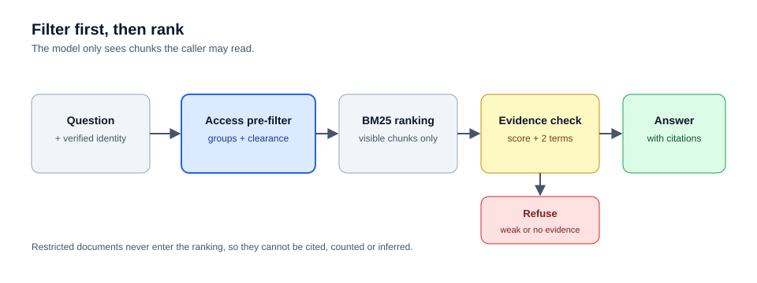

# permission-rag

[](https://github.com/santipaez/permission-rag/actions/workflows/ci.yml)


Permission-aware retrieval for RAG. The caller's identity filters the candidate set
**before** ranking, so the model only ever sees documents the caller is allowed to read.
An eval suite checks for leaks and fails the build if it finds one.



## Why filtering happens before ranking

The common pattern is retrieve first and filter after:

```python
hits = index.search(question, k=10)
visible = [h for h in hits if can_read(identity, h)]
```

It looks correct and it breaks in two ways:

- **Recall collapse.** If the top ten matches are restricted documents, the filtered list
  is empty. The caller gets "I don't know" about something the company documented, and the
  answer quality depends on who else is asking.
- **Existence leak.** Result counts and empty answers reveal that restricted documents
  exist. A few probes map the restricted corpus without reading a single line of it.

Filtering first removes both. The store scores only what the caller can see. Two tests pin
this behaviour:

| Test | What it proves |
|---|---|
| `test_restricted_match_never_leaks` | A top-scoring restricted chunk never reaches an unauthorised caller |
| `test_filtering_before_ranking_preserves_recall` | Ten restricted documents outranking the visible one still return the visible answer |

## Results

```
retrieval hit rate    9/9
refusal accuracy      5/5
acl leaks             0
```

The golden set (`evals/golden.jsonl`) has 14 questions. Nine need a specific document to be
cited. Five require a refusal: three ask for restricted content from accounts without the
group, and two ask about things the corpus cannot answer. `acl leaks` gates CI: any
non-zero value exits with status 1.

Real output from the command line, asking as an engineer:

```
$ python -m permrag "how do I rotate the redis access key" --as santi
user      santi  groups=['eng', 'people']  level=2
question  how do I rotate the redis access key
answer    Rotate the access key during a maintenance window, never in the middle of an incident. [1] Update the key in the platform secret store first, then restart one instance, confirm it reconnects, and only then roll the rest. [1] The cache layer runs on Azure Cache for Redis with one primary and two replicas in the same region. [2]
  [1] Redis failover runbook  (redis-runbook)
  [2] Redis failover runbook  (redis-runbook)
  [3] New starter onboarding  (onboarding)
  [4] New starter onboarding  (onboarding)
refused   False

$ python -m permrag "how do I rotate the redis access key" --as ana
answer    I don't have access to that information.
refused   True
```

The second query is the same question from an account without the `eng` group. It is
refused, and the restricted document is never cited.

## Design decisions

**Filter, then rank.** `KeywordStore.search` takes the identity, not just the query.

**Refuse on weak evidence.** An answer needs a minimum score and at least two distinct query
terms in the top chunk. A single shared word such as "level" is a coincidence, not evidence.
Without this rule, a question about compensation can be answered from a roadmap that happens
to mention levels.

**Extractive answers by default.** The offline model composes its answer only from retrieved
sentences, so it cannot invent facts, and the eval numbers stay meaningful with no cloud
account. Production swaps in a generative model behind the same `LLM` protocol.

**Dependency inversion.** `Rag` depends on a `Retriever` protocol and an `LLM` protocol, not
on concrete classes. Adapters replace the offline pieces without touching the access-control
logic.

## Quickstart

```bash
git clone https://github.com/santipaez/permission-rag && cd permission-rag
python -m unittest discover -s tests       # 14 tests, standard library only
python evals/run_evals.py                  # retrieval, refusal and leak report
python -m permrag "who approves access for a new starter" --as santi
python -m permrag "what is the quarterly revenue forecast" --as santi   # refused
python -m permrag "what is the quarterly revenue forecast" --as ana     # allowed
```

The demo identities live in `permrag/__main__.py`. In a real deployment the identity is built
from a validated token, and nothing in the request body decides who the caller is.

## Status of each part

| Component | Status |
|---|---|
| Visibility rule, chunking, keyword retrieval | Implemented and tested |
| Refusal policy and citations | Implemented and tested |
| Golden-set evals with leak gate | Implemented, runs offline |
| Azure OpenAI answer generation | Implemented, tested with an injected fake client |
| Live Azure OpenAI call | Not run against a real deployment yet |
| Azure AI Search retriever with ACL filter in the query | Planned, not implemented |

## Production path

- **Retrieval.** Azure AI Search, with a `groups` filterable field, hybrid vector and keyword
  search, and the ACL expressed as a filter in the query. It must never be a post-processing
  step.
- **Identity.** Entra ID tokens. App Roles or directory groups become `groups`, and a policy
  mapping sets `level`.
- **Observability.** Each question logs the caller, the retrieved chunk ids and the refusal
  flag, so refusals can be debugged and leaks audited afterwards.

## Limitations

- Offline retrieval is keyword-only. Questions that share no vocabulary with the documents
  will be refused. Vector search is the first thing to add.
- The two-term rule is a heuristic tuned on this corpus. A cross-encoder reranker with a
  calibrated threshold is the more rigorous option.
- Groups and clearance levels come from fixture files here. In production they come from a
  token, and the failure to watch for is group claims drifting from the source directory.
- A document is the unit of permission. Corpora that need per-chunk permissions need a richer
  model.
- The corpus is synthetic. It contains no real company material.

## Layout

```
permrag/
  core.py        documents, chunks, identities, visibility rule
  corpus.py      front-matter loader and paragraph-aware chunking
  store.py       BM25 keyword retrieval with access filtering before ranking
  llm.py         LLM protocol, extractive default, Azure OpenAI adapter
  rag.py         orchestration, refusal policy, citations
  __main__.py    command line entry point
data/corpus/     synthetic internal documents with groups and clearance levels
evals/           golden set and runner (exits 1 on any leak)
tests/           unit tests, including the adapter tested with a fake client
docs/            architecture diagram
```

## License

MIT
