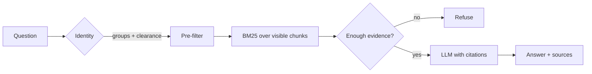

# permission-rag

**Access control is applied during retrieval, before a single document reaches the model.**

A small reference implementation of permission-aware retrieval. The caller's identity
filters the candidate set before ranking, so the model only sees documents the caller may
read. An eval suite checks for leaks and fails with a non-zero exit code if it finds one.

No cloud account required. Python standard library only in the core.

```bash
python -m unittest discover -s tests     # 11 tests
python evals/run_evals.py                # 9/9 retrieval, 5/5 refusal, 0 leaks
python -m permrag "how do I rotate the redis access key" --as santi
```

## The problem with the obvious implementation

The common pattern is retrieve, then filter:

```python
hits = index.search(question, k=10)
visible = [h for h in hits if can_read(identity, h)]
```

It looks correct and it fails in two ways.

**Recall collapse.** If the caller is an engineer and the top ten matches are all finance
documents, the filtered list is empty. The engineer is told "I don't know" about something
the company documented, and the retrieval quality silently depends on who else is asking.

**Existence leak.** Result counts and "no results" answers reveal that a document exists,
even when its content never appears. Repeat a few probes and you map the restricted
corpus without reading a word of it.

Filtering first removes both. The index scores only candidates the caller can see, so
recall is stable and the caller cannot tell restricted content from absent content.

Both failures are pinned by tests:

| Test | What it proves |
|---|---|
| `test_restricted_match_never_leaks` | A top-scoring restricted chunk never reaches an unauthorised caller |
| `test_filtering_before_ranking_preserves_recall` | Ten restricted documents outranking the visible one still return the visible answer |

## Architecture



Three deliberate choices:

**Filter, then rank.** `KeywordStore.search` takes the identity, not just a query.

**Refuse on weak evidence.** An answer needs a minimum score *and* at least two
independent query terms in the winning chunk. One shared word is a coincidence, not
evidence. Without that rule, "level" in a roadmap question answers a question about
compensation.

**Extractive answers by default.** The offline LLM composes its answer out of retrieved
sentences, so nothing can be hallucinated and the eval numbers mean something. The
production path swaps in Azure OpenAI behind the same interface.

## What the eval measures

```
retrieval hit rate    9/9
refusal accuracy      5/5
acl leaks             0
```

`leaks` is the one that gates CI. A non-zero value exits with status 1.

The refusal cases cover two situations: restricted content requested by an account
without the group (revenue forecast, compensation bands), and questions the corpus cannot
answer at all.

## Quickstart

```bash
git clone <repo> && cd permission-rag
python -m unittest discover -s tests
python evals/run_evals.py
python -m permrag "who approves access for a new starter" --as santi
python -m permrag "what is the quarterly revenue forecast" --as santi   # refuses
```

Try the same restricted question as `ana`, who holds the finance group:

```bash
python -m permrag "what is the quarterly revenue forecast" --as ana
```

## Production path

The offline core makes the access-control logic reviewable without an Azure subscription.
The Azure pieces are adapters behind the same interfaces. `AzureOpenAILLM` is written
against the Azure OpenAI and Entra ID APIs but has not been run against a live
deployment. An Azure AI Search retriever is planned, not implemented.

- **Retrieval**: Azure AI Search with a `groups` filterable field, hybrid (vector +
  keyword) and semantic ranking. The ACL filter stays in the query, never in a
  post-processing step.
- **Identity**: the `Identity` object is built from a validated Entra ID token: App Roles
  or directory groups become `groups`, and a policy mapping sets `level`. Nothing in the
  request body decides who the caller is.
- **Generation**: `AzureOpenAILLM` behind the same `LLM` protocol.
- **Ops**: every ask emits question, caller, retrieved chunk ids and refusal flag, so a
  refusal can be debugged and a leak can be audited after the fact.

## Limitations, stated on purpose

- Offline retrieval is keyword-only. Vectors would fix the cases where the question and
  the document share no vocabulary, and that is the first thing worth adding.
- The two-term rule is a heuristic, tuned against this corpus. A cross-encoder reranker
  with a calibrated threshold is the honest upgrade.
- Groups and clearance come from fixtures here. In production they come from a token, and
  the interesting failure is token group claims that drift from the source directory.
- No chunk-level ACLs. A document is the unit of permission, which is a simplification
  some real corpora cannot afford.

## Layout

```
permrag/
  core.py      Document, Chunk, Identity, visibility rule
  corpus.py    front-matter loader and paragraph-aware chunking
  store.py     BM25 with pre-filtering, stopwords
  llm.py       LLM protocol, extractive default, Azure OpenAI adapter
  rag.py       orchestration, refusal policy, citations
data/corpus/   sample documents with groups and clearance levels
evals/         golden set and runner (CI gate on leaks)
tests/         11 unit tests
```

MIT licensed.
